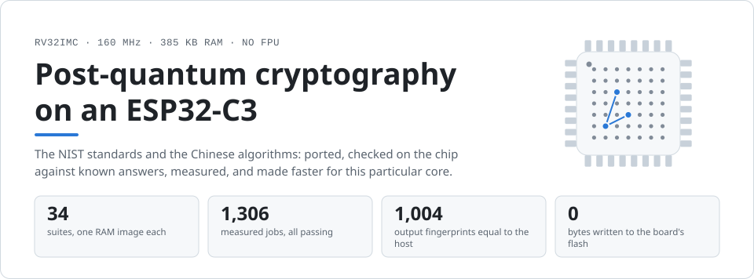
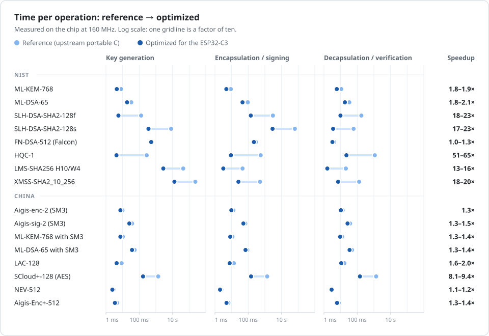
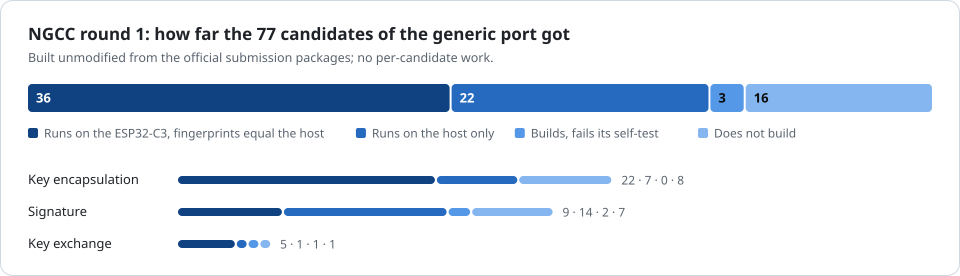
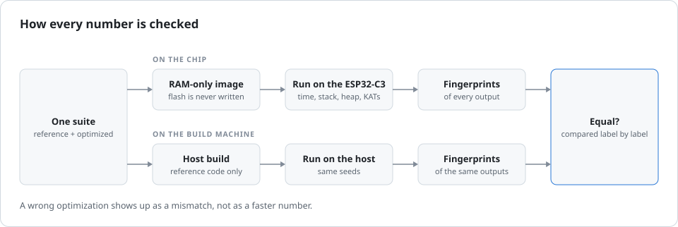

<p align="center">
  <picture>
    <source media="(prefers-color-scheme: dark)" srcset="docs/assets/hero-dark.svg">
    
  </picture>
</p>

<p align="center">
  <b>English</b> &nbsp;·&nbsp; <a href="README.zh-CN.md">简体中文</a>
</p>

<p align="center">
  <a href="docs/SUMMARY.md">Results by algorithm</a> &nbsp;·&nbsp;
  <a href="docs/RESULTS.md">Every measured job</a> &nbsp;·&nbsp;
  <a href="docs/ALGORITHMS.md">What is covered</a> &nbsp;·&nbsp;
  <a href="docs/FINDINGS.md">Findings</a> &nbsp;·&nbsp;
  <a href="docs/PORTING.md">Add an algorithm</a> &nbsp;·&nbsp;
  <a href="../../tree/optimization-journal/journal">Optimization journal</a>
</p>

This repository ports the post-quantum algorithms that NIST has standardized
or selected, and the Chinese ones that have a public implementation, to an
ESP32-C3: a 160 MHz RV32IMC core with about 385 KB of RAM and no FPU. Each one
is checked on the chip against known answers, measured, and then made faster
for this particular core. What does not fit the chip is listed with the
reason.

## Results

<p align="center">
  <picture>
    <source media="(prefers-color-scheme: dark)" srcset="docs/assets/speedup-dark.svg">
    
  </picture>
</p>

- **Hash-based signatures gain the most.** Their hash chains run on the chip's
  SHA-256 accelerator with the state kept inside the peripheral:
  SLH-DSA-SHA2-128f signs in 143 ms instead of 3 s, and XMSS-SHA2_10_256
  generates a key in 13 s instead of 236 s.
- **HQC is 51 to 82 times faster** with a multiplication that fits its sparse
  operands, in a third of the stack.
- **The lattice schemes run in milliseconds.** A complete ML-KEM-768 exchange
  (key generation, encapsulation, decapsulation) takes 15 ms; ML-DSA-65 signs
  in 45 ms.

<details>
<summary><b>The numbers behind the chart</b> — reference → optimized (speedup), one parameter set per family</summary>
<br>

<!-- results:begin -->
| Algorithm | Key generation | Encapsulation / signing | Decapsulation / verification | Stack + heap |
|---|---:|---:|---:|---:|
| ML-KEM-768 | 8.21 ms → 4.48 ms (1.8×) | 9.03 ms → 4.85 ms (1.9×) | 11.0 ms → 5.90 ms (1.9×) | 15.7 KB |
| ML-DSA-65 | 33.1 ms → 18.6 ms (1.8×) | 94.4 ms → 45.2 ms (2.1×) | 33.4 ms → 18.2 ms (1.8×) | 68.5 KB |
| SLH-DSA-SHA2-128f | 130 ms → 5.64 ms (23.0×) | 3046 ms → 143 ms (21.3×) | 176 ms → 9.79 ms (18.0×) | 4.3 KB |
| SLH-DSA-SHA2-128s | 8298 ms → 360 ms (23.0×) | 63.5 s → 2890 ms (22.0×) | 60.6 ms → 3.57 ms (17.0×) | 4.3 KB |
| FN-DSA-512 (Falcon) | 522 ms | 289 ms → 219 ms (1.3×) | 4.10 ms → 3.21 ms (1.3×) | 2.2 KB |
| HQC-1 | 281 ms → 4.29 ms (65.4×) | 561 ms → 9.11 ms (61.5×) | 1132 ms → 22.3 ms (50.8×) | 19.8 KB |
| LMS-SHA256 H10/W4 | 44.0 s → 2807 ms (15.7×) | 45.5 ms → 3.18 ms (14.3×) | 20.6 ms → 1.59 ms (13.0×) | 2.4 KB |
| XMSS-SHA2_10_256 | 235.9 s → 13.0 s (18.1×) | 511 ms → 25.7 ms (19.9×) | 130 ms → 7.10 ms (18.2×) | 4.1 KB |
| Aigis-enc-2 (SM3) | 9.79 ms → 7.38 ms (1.3×) | 12.8 ms → 9.65 ms (1.3×) | 13.3 ms → 10.4 ms (1.3×) | 15.3 KB |
| Aigis-sig-2 (SM3) | 37.3 ms → 25.4 ms (1.5×) | 66.8 ms → 51.0 ms (1.3×) | 37.2 ms → 26.1 ms (1.4×) | 85.6 KB |
| ML-KEM-768 with SM3 | 10.3 ms → 7.42 ms (1.4×) | 11.2 ms → 8.26 ms (1.4×) | 12.3 ms → 9.39 ms (1.3×) | 15.9 KB |
| ML-DSA-65 with SM3 | 53.0 ms → 36.9 ms (1.4×) | 88.1 ms → 68.7 ms (1.3×) | 48.6 ms → 34.6 ms (1.4×) | 79.9 KB |
| LAC-128 | 8.78 ms → 4.40 ms (2.0×) | 13.7 ms → 7.64 ms (1.8×) | 17.0 ms → 10.9 ms (1.6×) | 13.5 KB |
| SCloud+-128 (AES) | 1380 ms → 170 ms (8.1×) | 1372 ms → 148 ms (9.3×) | 1364 ms → 145 ms (9.4×) | 32.2 KB |
| NEV-512 | 2.87 ms → 2.43 ms (1.2×) | 2.41 ms → 2.02 ms (1.2×) | 3.04 ms → 2.87 ms (1.1×) | 6.5 KB |
| Aigis-Enc+-512 | 4.68 ms → 3.45 ms (1.4×) | 6.45 ms → 4.94 ms (1.3×) | 7.72 ms → 6.11 ms (1.3×) | 12.7 KB |
<!-- results:end -->

</details>

Every parameter set is in [docs/SUMMARY.md](docs/SUMMARY.md), and every
measured job with its stack and heap use in [docs/RESULTS.md](docs/RESULTS.md).
The reference column is the upstream portable C code; the optimized column
adds what this project wrote for the ESP32-C3.

## What is covered

**NIST**

| Algorithm | Status at NIST | On the chip |
|---|---|---|
| ML-KEM | FIPS 203 | 512, 768, 1024 |
| ML-DSA | FIPS 204 | 44, 65, 87, and a low-RAM build |
| SLH-DSA | FIPS 205 | all 12 parameter sets |
| FN-DSA (Falcon) | FIPS 206, not final yet | 512, 1024, floating point emulated |
| HQC | selected in 2025 | HQC-1, HQC-3, HQC-5 |
| LMS, HSS | SP 800-208 | SHA-256, SHA-256/192 and SHAKE256, heights 5 and 10 |
| XMSS, XMSS^MT | SP 800-208 | SHA-2 and SHAKE256, height 10 and 20/4 |

**China**

| Algorithm | What it is | On the chip |
|---|---|---|
| Aigis-enc, Aigis-sig | lattice KEM and signature | all sets, with SM3 and with SHAKE |
| ML-KEM, ML-DSA, SLH-DSA with SM3 | the NIST schemes with SM3 as the hash | all sets of PQMagic |
| SPHINCS-alpha | hash-based signature | 128f, 128s, 192f |
| LMS, HSS, XMSS^MT with SM3; Kyber-768 | GmSSL's implementations | verified |
| LAC | lattice KEM | Light, 128, 192, 256 |
| SCloud+ | LWE KEM, NGCC candidate | 128, 192, 256 with SM3, SHAKE and AES |
| NEV, NEV-AKE, Aigis-Enc+, Aigis-Sig+ | NGCC candidates | 12 + 9 + 3 + 1 sets |

The first round of China's call for next-generation commercial cryptography
(NGCC, September 2026) has 84 public-key candidates. Seven were taken from
open implementations instead: five have the suites of their own listed above,
and ReSolveD-alpha and QIMEN-PIKE do not fit the chip. The other 77 were built
straight from their official submission packages by one generic suite:

<p align="center">
  <picture>
    <source media="(prefers-color-scheme: dark)" srcset="docs/assets/ngcc-dark.svg">
    
  </picture>
</p>

Names, times, memory and the reason for every candidate that did not reach
the chip are in [docs/ngcc/status.md](docs/ngcc/status.md). The full list of
what is covered, with licenses and what does not fit, is
[docs/ALGORITHMS.md](docs/ALGORITHMS.md).

## Where the speed came from

| What was done | Effect | Who gains |
|---|---|---|
| **SHA-256 accelerator**, with the hash state kept in the peripheral and two hashes in flight | one hash in 200 to 280 cycles instead of 4400 | SLH-DSA-SHA2-128 17–23×, XMSS 14–23×, LMS 4–27× |
| **Sparse polynomial product** in place of dense Karatsuba | 51–82×, a third of the stack | HQC |
| **AES accelerator** and packed matrix products | 6.6–9.4× | SCloud+ with AES; LAC 1.2–2.2× |
| **Keccak-f[1600] in RV32IMC assembly**, assembly polynomial arithmetic | 79 µs per permutation instead of 135 µs | ML-KEM and ML-DSA 1.8–2.1×; SHAKE-based hash signatures 1.5–2× |
| **32-bit emulated floating point** | 1.3× | FN-DSA signing |
| **Faster SM3** | 1.2–1.5× | every SM3 instantiation |
| **Compact encoding table** | 278 KB → 50 KB | SPHINCS-alpha fits in RAM at all |
| **Low-RAM builds** | ML-DSA-65 in 13.5 KB instead of 68.5 KB | ML-DSA, Aigis-sig |

How each of these was found, what was tried and rejected, the limits of the
chip, and the defects found in upstream code on a 32-bit target:
[docs/FINDINGS.md](docs/FINDINGS.md).

## How it is checked

<p align="center">
  <picture>
    <source media="(prefers-color-scheme: dark)" srcset="docs/assets/pipeline-dark.svg">
    
  </picture>
</p>

Every suite runs the known-answer tests its upstream ships, on the chip. On
top of that, every key, ciphertext, signature and shared secret is
fingerprinted on the chip and compared with a second build of the reference
code on the build machine. The optimized variant must produce the same bytes
as the reference.

## Run it

You need ESP-IDF v5.5 and an ESP32-C3 on USB.

```sh
export IDF_PATH=~/esp/esp-idf             # wherever ESP-IDF lives
tools/pqc run mlkem --check               # build, load into RAM, run, compare with the host
tools/pqc run slhdsa -f slhdsa-sha2-128f  # only the jobs whose name contains the text
python3 tools/report.py                   # regenerate docs/RESULTS.md, docs/SUMMARY.md and the table above
python3 tools/figures.py                  # regenerate the figures of this page
```

> [!NOTE]
> Nothing here writes to the board's flash. Each suite is built as a RAM-only
> image and loaded with `esptool load_ram`; after a reset the board runs its
> own firmware again.

Suites are the directories under `suites/`. SCloud+, LAC and the NGCC
packages have no redistribution license, so their code is fetched first:
`tools/fetch/scloudplus.sh`, `tools/fetch/lac.sh`, and
[docs/ngcc/README.md](docs/ngcc/README.md) for the NGCC candidates. To add an
algorithm, see [docs/PORTING.md](docs/PORTING.md).

## Before you use any of it

> [!WARNING]
> This is a measurement project, not a hardened library.
>
> - Constant-time behaviour is not guaranteed by the C source: the compiler
>   was seen turning masked selects into branches.
> - Nothing is protected against power or electromagnetic analysis.
> - The fast HQC product is only safe on a core without a data cache.
> - The benchmarks use a seeded random generator, and everything was measured
>   running from RAM.
> - The SM3 instantiations and the NGCC candidates are not standards, and
>   several NGCC candidates have published attacks.
>
> The full list is at the end of [docs/FINDINGS.md](docs/FINDINGS.md).

## Repository

```
suites/<name>/        one algorithm family = one RAM image; NOTES.md explains each
components/prims/     Keccak, SHA-2, SM3 with a reference/optimized switch
components/bench/     harness: time, stack and heap per operation, fingerprints
third_party/          upstream code whose license allows redistribution
tools/                pqc (build, load, run, compare), report.py, figures.py, fetch scripts
results/              the measurements, one JSON file per suite
docs/                 SUMMARY, RESULTS, ALGORITHMS, FINDINGS, PORTING, ngcc/
```

| Branch | What it holds |
|---|---|
| [`main`](../../tree/main) | the final result |
| [`optimization-journal`](../../tree/optimization-journal) | the working record: every optimization attempt with its numbers and verdict, the reports of each line of work, a timeline, and the intermediate commits |

## Licenses

Code under `third_party/` keeps its own license; each directory has the
license text and a `SOURCE.md` with the origin and local changes. The NIST
ACVP sample vectors used by the SLH-DSA suite carry NIST's notice next to
them. No license has been chosen yet for the code written in this project.
