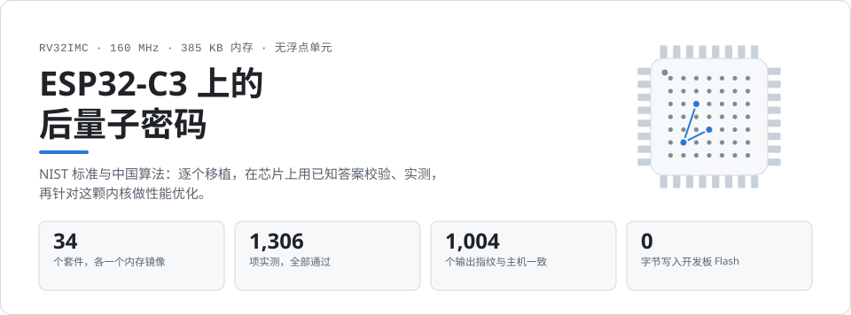
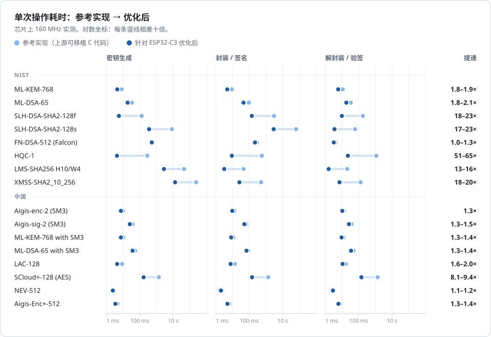
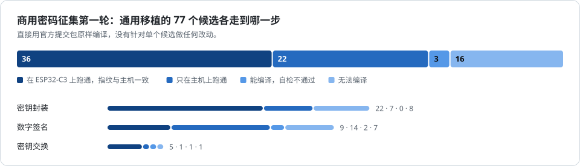
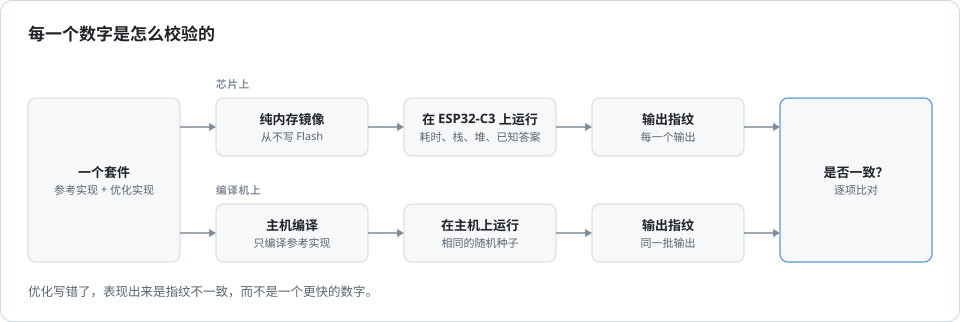

<p align="center">
  <picture>
    <source media="(prefers-color-scheme: dark)" srcset="docs/assets/hero-zh-dark.svg">
    
  </picture>
</p>

<p align="center">
  <a href="README.md">English</a> &nbsp;·&nbsp; <b>简体中文</b>
</p>

<p align="center">
  <a href="docs/SUMMARY.md">各算法结果</a> &nbsp;·&nbsp;
  <a href="docs/RESULTS.md">全部实测数据</a> &nbsp;·&nbsp;
  <a href="docs/ALGORITHMS.md">覆盖范围</a> &nbsp;·&nbsp;
  <a href="docs/FINDINGS.md">发现与结论</a> &nbsp;·&nbsp;
  <a href="docs/PORTING.md">新增算法</a> &nbsp;·&nbsp;
  <a href="../../tree/optimization-journal/journal">优化过程记录</a>
</p>

这个仓库把 NIST 已标准化或已选定的后量子算法，以及中国已有公开实现的后量子算法，
移植到一块 ESP32-C3 上：160 MHz 的 RV32IMC 内核，约 385 KB 内存，没有浮点单元。
每个算法都在芯片上用已知答案校验正确性并实测，再针对这颗内核做性能优化。放不进
这块芯片的算法也逐一列出原因。

## 结果

<p align="center">
  <picture>
    <source media="(prefers-color-scheme: dark)" srcset="docs/assets/speedup-zh-dark.svg">
    
  </picture>
</p>

- **哈希签名提速最多。** 哈希链直接跑在芯片的 SHA-256 硬件加速器上，中间状态
  留在外设里：SLH-DSA-SHA2-128f 签名从 3 秒降到 143 毫秒，XMSS-SHA2_10_256
  生成密钥从 236 秒降到 13 秒。
- **HQC 快了 51 到 82 倍。** 换用适合稀疏操作数的乘法，栈占用只有原来的三分之一。
- **格密码都在毫秒级。** 一次完整的 ML-KEM-768 密钥交换（密钥生成、封装、解封装）
  共 15 毫秒；ML-DSA-65 签名 45 毫秒。

<details>
<summary><b>图中的具体数字</b> — 参考实现 → 优化后（提速倍数），每个算法族一组代表参数</summary>
<br>

<!-- results:begin -->
| 算法 | 密钥生成 | 封装 / 签名 | 解封装 / 验签 | 栈 + 堆 |
|---|---:|---:|---:|---:|
| ML-KEM-768 | 8.21 ms → 4.48 ms (1.8×) | 9.03 ms → 4.85 ms (1.9×) | 11.0 ms → 5.90 ms (1.9×) | 15.7 KB |
| ML-DSA-65 | 33.1 ms → 18.6 ms (1.8×) | 94.4 ms → 45.2 ms (2.1×) | 33.4 ms → 18.2 ms (1.8×) | 68.5 KB |
| SLH-DSA-SHA2-128f | 130 ms → 5.64 ms (23.0×) | 3046 ms → 143 ms (21.3×) | 176 ms → 9.79 ms (18.0×) | 4.3 KB |
| SLH-DSA-SHA2-128s | 8298 ms → 360 ms (23.0×) | 63.5 s → 2890 ms (22.0×) | 60.6 ms → 3.57 ms (17.0×) | 4.3 KB |
| FN-DSA-512 (Falcon) | 522 ms | 289 ms → 219 ms (1.3×) | 4.10 ms → 3.21 ms (1.3×) | 2.2 KB |
| HQC-1 | 281 ms → 4.29 ms (65.4×) | 561 ms → 9.11 ms (61.5×) | 1132 ms → 22.3 ms (50.8×) | 19.8 KB |
| LMS-SHA256 H10/W4 | 44.0 s → 2807 ms (15.7×) | 45.5 ms → 3.18 ms (14.3×) | 20.6 ms → 1.59 ms (13.0×) | 2.4 KB |
| XMSS-SHA2_10_256 | 235.9 s → 13.0 s (18.1×) | 511 ms → 25.7 ms (19.9×) | 130 ms → 7.10 ms (18.2×) | 4.1 KB |
| Aigis-enc-2 (SM3) | 9.79 ms → 7.38 ms (1.3×) | 12.8 ms → 9.65 ms (1.3×) | 13.3 ms → 10.4 ms (1.3×) | 15.3 KB |
| Aigis-sig-2 (SM3) | 37.3 ms → 25.4 ms (1.5×) | 66.8 ms → 51.0 ms (1.3×) | 37.2 ms → 26.1 ms (1.4×) | 85.6 KB |
| ML-KEM-768 with SM3 | 10.3 ms → 7.42 ms (1.4×) | 11.2 ms → 8.26 ms (1.4×) | 12.3 ms → 9.39 ms (1.3×) | 15.9 KB |
| ML-DSA-65 with SM3 | 53.0 ms → 36.9 ms (1.4×) | 88.1 ms → 68.7 ms (1.3×) | 48.6 ms → 34.6 ms (1.4×) | 79.9 KB |
| LAC-128 | 8.78 ms → 4.40 ms (2.0×) | 13.7 ms → 7.64 ms (1.8×) | 17.0 ms → 10.9 ms (1.6×) | 13.5 KB |
| SCloud+-128 (AES) | 1380 ms → 170 ms (8.1×) | 1372 ms → 148 ms (9.3×) | 1364 ms → 145 ms (9.4×) | 32.2 KB |
| NEV-512 | 2.87 ms → 2.43 ms (1.2×) | 2.41 ms → 2.02 ms (1.2×) | 3.04 ms → 2.87 ms (1.1×) | 6.5 KB |
| Aigis-Enc+-512 | 4.68 ms → 3.45 ms (1.4×) | 6.45 ms → 4.94 ms (1.3×) | 7.72 ms → 6.11 ms (1.3×) | 12.7 KB |
<!-- results:end -->

</details>

全部参数组见 [docs/SUMMARY.md](docs/SUMMARY.md)，每一项测量及其栈、堆占用见
[docs/RESULTS.md](docs/RESULTS.md)。“参考实现”是上游的可移植 C 代码，“优化后”
加上了本项目为 ESP32-C3 写的部分。

## 覆盖范围

**NIST**

| 算法 | 在 NIST 的状态 | 芯片上跑通的参数 |
|---|---|---|
| ML-KEM | FIPS 203 | 512、768、1024 |
| ML-DSA | FIPS 204 | 44、65、87，另有省内存版本 |
| SLH-DSA | FIPS 205 | 全部 12 组参数 |
| FN-DSA（Falcon） | FIPS 206，尚未定稿 | 512、1024，浮点为软件模拟 |
| HQC | 2025 年选定 | HQC-1、HQC-3、HQC-5 |
| LMS、HSS | SP 800-208 | SHA-256、SHA-256/192、SHAKE256，树高 5 和 10 |
| XMSS、XMSS^MT | SP 800-208 | SHA-2 和 SHAKE256，树高 10 和 20/4 |

**中国**

| 算法 | 类型 | 芯片上跑通的参数 |
|---|---|---|
| Aigis-enc、Aigis-sig | 格密码，密钥封装与签名 | 全部参数，SM3 版和 SHAKE 版 |
| ML-KEM、ML-DSA、SLH-DSA 的 SM3 版 | 把 NIST 方案里的哈希换成 SM3 | PQMagic 提供的全部参数 |
| SPHINCS-alpha | 哈希签名 | 128f、128s、192f |
| LMS、HSS、XMSS^MT 的 SM3 版，Kyber-768 | GmSSL 的实现 | 已校验 |
| LAC | 格密码，密钥封装 | Light、128、192、256 |
| SCloud+ | LWE 密钥封装，征集候选 | 128、192、256，SM3、SHAKE、AES 三个版本 |
| NEV、NEV-AKE、Aigis-Enc+、Aigis-Sig+ | 征集候选 | 12 + 9 + 3 + 1 组参数 |

新一代商用密码算法征集第一轮（2026 年 9 月公布）共有 84 个公钥候选。其中 7 个
改用开源实现单独处理：5 个就是上表里有自己套件的，ReSolveD-alpha 和 QIMEN-PIKE
放不进这块芯片。其余 77 个由一个通用套件直接从官方提交包编译：

<p align="center">
  <picture>
    <source media="(prefers-color-scheme: dark)" srcset="docs/assets/ngcc-zh-dark.svg">
    
  </picture>
</p>

每个候选的名称、耗时、内存，以及没能上芯片的原因，见
[docs/ngcc/status.md](docs/ngcc/status.md)。完整的覆盖清单（含许可和放不下的
部分）见 [docs/ALGORITHMS.md](docs/ALGORITHMS.md)。

## 速度是从哪里来的

| 做了什么 | 效果 | 受益的算法 |
|---|---|---|
| **SHA-256 硬件加速器**：哈希状态留在外设里，两路哈希交替进行 | 一次哈希约 200–280 个周期，纯软件约 4400 个 | SLH-DSA-SHA2-128 提速 17–23 倍，XMSS 14–23 倍，LMS 4–27 倍 |
| **稀疏多项式乘法**，替代稠密 Karatsuba | 51–82 倍，栈占用为三分之一 | HQC |
| **AES 硬件加速器**，加上打包的矩阵乘法 | 6.6–9.4 倍 | SCloud+ 的 AES 版；LAC 1.2–2.2 倍 |
| **Keccak-f[1600] 的 RV32IMC 汇编**，多项式运算汇编 | 每次置换 79 µs，C 实现为 135 µs | ML-KEM、ML-DSA 1.8–2.1 倍；基于 SHAKE 的哈希签名 1.5–2 倍 |
| **32 位软件浮点** | 1.3 倍 | FN-DSA 签名 |
| **更快的 SM3** | 1.2–1.5 倍 | 所有 SM3 版算法 |
| **紧凑编码表** | 278 KB → 50 KB | SPHINCS-alpha 因此才放得进内存 |
| **省内存版本** | ML-DSA-65 从 68.5 KB 降到 13.5 KB | ML-DSA、Aigis-sig |

每项优化是怎么找到的、哪些尝试被放弃、这块芯片的限制，以及在 32 位平台上发现的
上游代码缺陷，见 [docs/FINDINGS.md](docs/FINDINGS.md)。

## 怎么校验

<p align="center">
  <picture>
    <source media="(prefers-color-scheme: dark)" srcset="docs/assets/pipeline-zh-dark.svg">
    
  </picture>
</p>

每个套件都在芯片上运行上游自带的已知答案测试。此外，芯片上产生的每一个密钥、
密文、签名和共享密钥都会取指纹，与编译机上另行编译的参考实现逐项比对。优化版
必须和参考版输出完全相同的字节。

## 怎么运行

需要 ESP-IDF v5.5 和一块通过 USB 连接的 ESP32-C3。

```sh
export IDF_PATH=~/esp/esp-idf             # ESP-IDF 所在目录
tools/pqc run mlkem --check               # 编译、加载到内存、运行、与主机比对
tools/pqc run slhdsa -f slhdsa-sha2-128f  # 只运行名字里含这段文字的测试项
python3 tools/report.py                   # 重新生成 docs/RESULTS.md、docs/SUMMARY.md 和上面的表格
python3 tools/figures.py                  # 重新生成本页的配图
```

> [!NOTE]
> 整个项目不写开发板的 Flash。每个套件编译成只在内存中运行的镜像，用
> `esptool load_ram` 加载；复位之后，开发板仍然运行它原来的固件。

`suites/` 下每个目录是一个套件。SCloud+、LAC 和商用密码征集的提交包没有再分发
许可，需要先下载源码：`tools/fetch/scloudplus.sh`、`tools/fetch/lac.sh`，征集
候选见 [docs/ngcc/README.md](docs/ngcc/README.md)。新增算法的方法见
[docs/PORTING.md](docs/PORTING.md)。

## 使用前请注意

> [!WARNING]
> 这是一个测量项目，不是加固过的密码库。
>
> - C 源码并不能保证恒定时间：实测编译器会把掩码选择编译成条件分支。
> - 没有任何抗功耗分析或电磁分析的措施。
> - HQC 的快速乘法只在没有数据缓存的内核上安全。
> - 基准测试用的是固定种子的随机数发生器，所有数据都是从内存运行测得的。
> - SM3 版算法和征集候选都不是标准，其中若干候选已有公开的攻击。
>
> 完整清单在 [docs/FINDINGS.md](docs/FINDINGS.md) 末尾。

## 仓库结构

```
suites/<name>/        一个算法族对应一个内存镜像；NOTES.md 说明细节
components/prims/     Keccak、SHA-2、SM3，可在参考实现和优化实现之间切换
components/bench/     测试框架：每个操作的耗时、栈和堆占用、输出指纹
third_party/          许可允许再分发的上游代码
tools/                pqc（编译、加载、运行、比对）、report.py、figures.py、下载脚本
results/              测量结果，每个套件一个 JSON 文件
docs/                 SUMMARY、RESULTS、ALGORITHMS、FINDINGS、PORTING、ngcc/
```

| 分支 | 内容 |
|---|---|
| [`main`](../../tree/main) | 最终结果 |
| [`optimization-journal`](../../tree/optimization-journal) | 过程记录：每一次优化尝试的前后数据和结论、各条工作线的报告、时间线，以及中间版本的提交历史 |

## 许可

`third_party/` 下的代码沿用各自的许可，每个目录里有许可全文和记录来源与本地
改动的 `SOURCE.md`。SLH-DSA 套件使用的 NIST ACVP 样例向量旁附有 NIST 的声明。
本项目自己编写的代码尚未选定许可。
